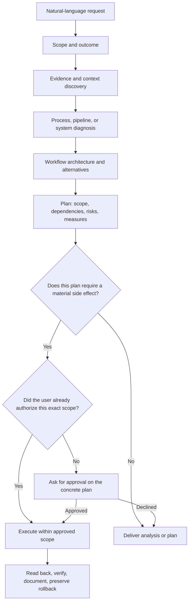

# Decision record: a separate strategic layer

**Status:** accepted for the first installed version  
**Date:** 2026-10-20

## Decision

Create `kommo-strategic-automation-architect` as a sibling, top-level Codex skill. Keep the existing `kommo-crm` skill intact and use it as the technical Kommo specialist when implementation or Kommo-specific mechanics are needed.

## Why this fits the requested workflow

The supplied architecture places a strategic coordinator between natural-language requests and execution. That coordinator must choose the scope, gather business and system evidence, diagnose, design, present a plan, and only then hand approved work to an implementation layer. Those responsibilities are broader than Kommo API or interface mechanics.

The existing technical skill already carries accumulated Kommo knowledge. Rewriting it as a general commercial brain would mix separate concerns and make future technical maintenance harder. Nesting the technical skill inside the brain would also make it less independently reusable. A sibling skill keeps both discoverable and provides a clear handoff.

## Alternatives considered

| Option | Result |
| --- | --- |
| Add strategic orchestration inside `kommo-crm` | Rejected: couples business strategy to technical operations and would modify a skill the user asked to preserve. |
| Convert `kommo-crm` into the strategic architect | Rejected: loses a clean technical specialist boundary and risks overwriting established behavior. |
| Install every source skill as a separate global skill | Rejected: many overlap; several assume HubSpot/Salesforce, other connectors, or fixed benchmarks; automatic routing would become noisy and conflicting. |
| Add one strategic sibling skill with focused internal modules | Selected: one entrypoint coordinates discovery and proposals; conditional modules provide methods; the technical skill remains the Kommo executor/reference. |

## Request flow

## Source integration model

The 23 numbered positions in the user's list resolve to 25 URL entries: item 10 groups three sources and the customer-success repository appears twice. That leaves 24 unique URLs. They are mapped into seven on-demand playbooks: context discovery; CRM/workflow design; RevOps/pipeline/metrics; sales operations; automation governance/bulk changes; customer lifecycle; and documentation/visuals. The source register maps each URL to the playbook and records how platform-specific rules and licensing are handled.

The project adapts general methods in original language. It does not bundle or reproduce the external skill files. Numeric thresholds, platform commands, connector assumptions, compliance interpretations, and scoring formulas are not carried over as Kommo defaults.

## Operational boundary

Strategic diagnosis is read-only unless the user authorizes otherwise. A proposal is not permission to activate an automation, edit CRM data, perform a bulk operation, or send a message. A direct, bounded user request may authorize the corresponding action; if scope, side effect, target, or risk materially changes, obtain approval for the concrete revised plan. Kommo mechanics are delegated to the currently installed `kommo-crm` skill.

## Consequences

- The brain can evolve without changing the existing technical skill.
- Each internal playbook can be updated or retired independently and is loaded only when relevant.
- The source register supports attribution and license review without copying third-party prompts.
- The user or Codex may need a new conversation/skill-picker refresh after global installation.
- This version does not itself promise that an account's connector, permissions, or Kommo configuration are available; every task must verify its own access and evidence.
