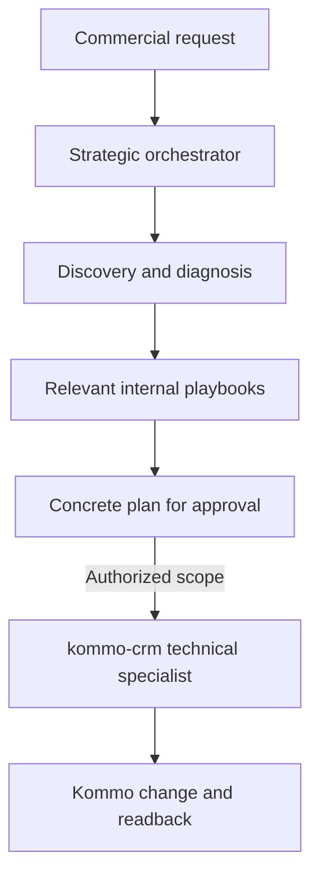

# Cerebro Comercial — Kommo

`kommo-strategic-automation-architect` is a proprietary Codex skill that coordinates commercial discovery, RevOps diagnosis, workflow architecture, and approval-ready automation proposals around Kommo. It sits **above** the existing `kommo-crm` technical skill, which remains separate and unchanged.

## What this package is for

Use the orchestrator when a request crosses business process, pipeline, metrics, integrations, or automation design. It selects only the relevant internal playbook, gathers current evidence, and presents a specific plan before material changes. For a narrow Kommo read or operation, use `kommo-crm` directly.

The package contains original, task-focused guidance informed by the linked references in [`SOURCE_REGISTER.md`](SOURCE_REGISTER.md). Those URLs are research sources, not skills installed in Codex; [`routing-and-activation.md`](skills/kommo-strategic-automation-architect/references/routing-and-activation.md) explains how each source maps to an internal playbook or a real skill available in the current environment. The repository does not vendor third-party skill files or contain account snapshots, CRM exports, credentials, or customer data.

## Install in Codex

Copy the folder `skills/kommo-strategic-automation-architect` into the global skills directory:

```powershell
$source = 'C:\Users\Usuário\Documents\Codex\cerebro_comercial_skill\skills\kommo-strategic-automation-architect'
$destination = 'C:\Users\Usuário\.codex\skills\kommo-strategic-automation-architect'
if (Test-Path -LiteralPath $destination) { throw "Destination already exists: $destination" }
Copy-Item -LiteralPath $source -Destination $destination -Recurse
```

Start a new conversation or refresh the skill picker if Codex has not discovered it yet. To update a later installation, compare the source and installed files first, preserve any local changes, then replace only the intended skill folder and verify the copy.

## Architecture choice

The orchestrator is a **separate top-level skill**. Nesting it inside `kommo-crm` would couple strategic routing to the technical skill and risk changing its established behavior. Turning `kommo-crm` into the brain would blur the technical boundary and complicate maintenance. The sibling design preserves a stable handoff:



This image from the user is represented as a workflow: request → orchestrator → discovery/diagnosis/architecture/planning → approval-ready plan → authorized implementation and verification. The approval gate applies to material changes; it does not require asking twice when the user's request already authorizes the exact, bounded action.

## What's in the repository

| Path | Purpose |
| --- | --- |
| `skills/kommo-strategic-automation-architect/SKILL.md` | Codex entrypoint and routing rules |
| `skills/kommo-strategic-automation-architect/references/` | Focused playbooks loaded only when relevant |
| `SOURCE_REGISTER.md` | Inventory, adaptation notes, and license/source attribution |
| `skills/kommo-strategic-automation-architect/references/kommo-native-automation.md` | Native AI agent, Salesbot, and AI suggestion design guidance |
| `Interface e Recursos do Kommo/Agente de IA Nativo/MAPA_RECURSOS.md` | Local screenshot index and feature map; raw PNGs remain ignored by Git |
| `ARCHITECTURE.md` | Decision record for the separate orchestration layer |
| `LICENSE` | Proprietary terms for this original package |

## Design rules

- Do not install the supplied source set as competing global routers. Keep one discoverable orchestrator and route to focused internal references.
- Reuse methods, not platform-specific commands. HubSpot CLI/workflow details do not apply to Kommo.
- Treat thresholds, SLA values, scoring weights, and benchmarks in source material as examples until supported by this organization's own evidence.
- Use source links for attribution and future review; no third-party skill text is included in the package.
- Keep `kommo-crm` technically authoritative. This repository neither copies nor changes it.
- Keep the repository private while the skill is proprietary and under active development.

## Refreshing source material

Source projects can change. Before adopting an update, review the current upstream file, license, platform assumptions, and behavior against the local Kommo skill and this package's approval model. Update [`SOURCE_REGISTER.md`](SOURCE_REGISTER.md) with the review date and any change in license or adaptation. Do not auto-import upstream instructions.
