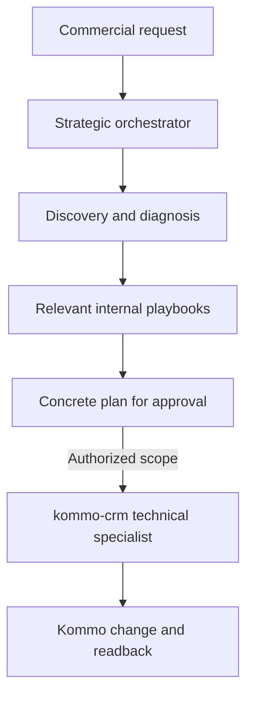

# Cerebro Comercial — Kommo

`kommo-strategic-automation-architect` is a proprietary Codex skill that coordinates commercial discovery, RevOps diagnosis, workflow architecture, and approval-ready automation proposals around Kommo. It sits **above** the existing `kommo-crm` technical skill, which remains separate and unchanged. A narrow companion entrypoint, `kommo-strategic-automation-architect-agentes-ia`, loads the detailed Kommo AI module directly.

## What this package is for

Use the orchestrator when a request crosses business process, pipeline, metrics, integrations, or automation design. It selects only the relevant internal playbook, gathers current evidence, and presents a specific plan before material changes. For a narrow Kommo read or operation, use `kommo-crm` directly.

The tracked package contains original, task-focused guidance informed by the linked references in [`SOURCE_REGISTER.md`](SOURCE_REGISTER.md). Those URLs are research sources, not skills installed in Codex; [`routing-and-activation.md`](skills/kommo-strategic-automation-architect/references/routing-and-activation.md) explains how each source maps to an internal playbook or a real skill available in the current environment. Tracked skill files do not vendor third-party skills or include account snapshots, CRM exports, credentials, or customer data. Local untracked inputs are not part of the installed skill or Git publication.

## Install in Codex

Copy both skill folders into the global skills directory. The focused AI entrypoint reads the reference inside the strategic skill, so keep both folders installed together:

```powershell
$sourceRoot = 'C:\Users\Usuário\Documents\Codex\cerebro_comercial_skill\skills'
$destinationRoot = 'C:\Users\Usuário\.codex\skills'
$skillNames = @(
    'kommo-strategic-automation-architect',
    'kommo-strategic-automation-architect-agentes-ia'
)
foreach ($skillName in $skillNames) {
    $source = Join-Path $sourceRoot $skillName
    $destination = Join-Path $destinationRoot $skillName
    if (Test-Path -LiteralPath $destination) { throw "Destination already exists: $destination" }
    Copy-Item -LiteralPath $source -Destination $destination -Recurse
}
```

Start a new conversation or refresh the skill picker if Codex has not discovered it yet. To update a later installation, compare the source and installed files first, preserve any local changes, then replace only the intended skill folder and verify the copy.

## Architecture choice

The orchestrator is a **separate top-level skill**. Nesting it inside `kommo-crm` would couple strategic routing to the technical skill and risk changing its established behavior. Turning `kommo-crm` into the brain would blur the technical boundary and complicate maintenance. The sibling design preserves a stable handoff:



This image from the user is represented as a workflow: request → orchestrator → discovery/diagnosis/architecture/planning → approval-ready plan → authorized implementation and verification. The approval gate applies to material changes; it does not require asking twice when the user's request already authorizes the exact, bounded action.

## What's in the repository

| Path | Purpose |
| --- | --- |
| `skills/kommo-strategic-automation-architect/SKILL.md` | Strategic Codex entrypoint and routing rules |
| `skills/kommo-strategic-automation-architect/references/agentes-ia.md` | Detailed Portuguese reference and source index for Kommo AI and native AI agents |
| `skills/kommo-strategic-automation-architect/references/kommo-bots-playbooks-and-api.md` | Salesbot library patterns, manual runs, JSON, triggers, and public API boundaries |
| `skills/kommo-strategic-automation-architect-agentes-ia/SKILL.md` | Focused Codex entrypoint that loads the shared AI reference |
| `skills/kommo-strategic-automation-architect/references/` | Focused playbooks loaded only when relevant |
| `SOURCE_REGISTER.md` | Inventory, adaptation notes, and license/source attribution |
| `skills/kommo-strategic-automation-architect/references/kommo-native-automation.md` | Native AI agent, Salesbot, and AI suggestion design guidance |
| `Interface e Recursos do Kommo/Agente de IA Nativo/MAPA_RECURSOS.md` | Local screenshot index and feature map; raw PNGs remain ignored by Git |
| `ARCHITECTURE.md` | Decision record for the separate orchestration layer |
| `LICENSE` | Proprietary terms for this original package |

## Design rules

- Do not install the supplied source set as competing global routers. Keep one strategic orchestrator; the focused AI entrypoint delegates to its shared reference and does not create a second source of truth.
- Reuse methods, not platform-specific commands. HubSpot CLI/workflow details do not apply to Kommo.
- Treat thresholds, SLA values, scoring weights, and benchmarks in source material as examples until supported by this organization's own evidence.
- Use source links for attribution and future review; no third-party skill text is included in the package.
- Keep `kommo-crm` technically authoritative. This repository neither copies nor changes it.
- The Kommo AI module is an original synthesis linked to official Kommo pages, not a verbatim mirror of their articles.
- Keep the repository private while the skill is proprietary and under active development.

## Refreshing source material

Source projects can change. Before adopting an update, review the current upstream file, license, platform assumptions, and behavior against the local Kommo skill and this package's approval model. Update [`SOURCE_REGISTER.md`](SOURCE_REGISTER.md) with the review date and any change in license or adaptation. Do not auto-import upstream instructions.

## Protocolo de desenvolvimento e continuidade

Antes de desenvolver, siga [AGENTS.md](AGENTS.md): reinspecione o repositório remoto,
consulte os módulos afetados e trabalhe em branch para revisão por Pull Request.
Toda implementação deve atualizar o inventário e produzir um relatório com evidências,
testes, decisões, limitações e próximos passos para o arquiteto ChatGPT.

- [Protocolo e validações locais](docs/relatorios-codex/README.md).
- [Último relatório de continuidade](docs/relatorios-codex/ULTIMO_RELATORIO.md).
- [Histórico inicial — Tarefa 001](docs/relatorios-codex/historico/2026-10-22-governanca-continuidade.md).
- [Inventário estruturado da skill](docs/estado/ESTADO_DA_SKILL.json).

Os estados do inventário distinguem documentação, implementação e validação com escopo
explícito. Validação estrutural local não comprova operação em uma conta Kommo real.

Pull Requests para `main` executam as verificações de governança no GitHub Actions. A execução
manual e os comandos locais estão descritos no [protocolo de validação](docs/relatorios-codex/README.md);
o check só bloqueia o merge se for exigido nas regras de proteção da branch.
